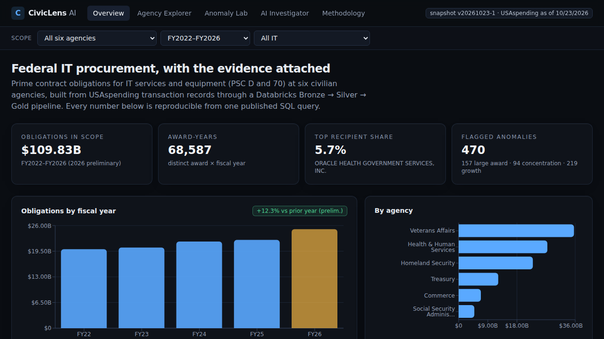
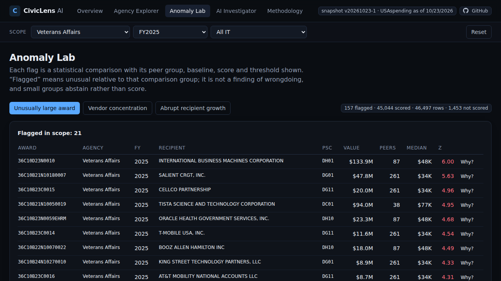
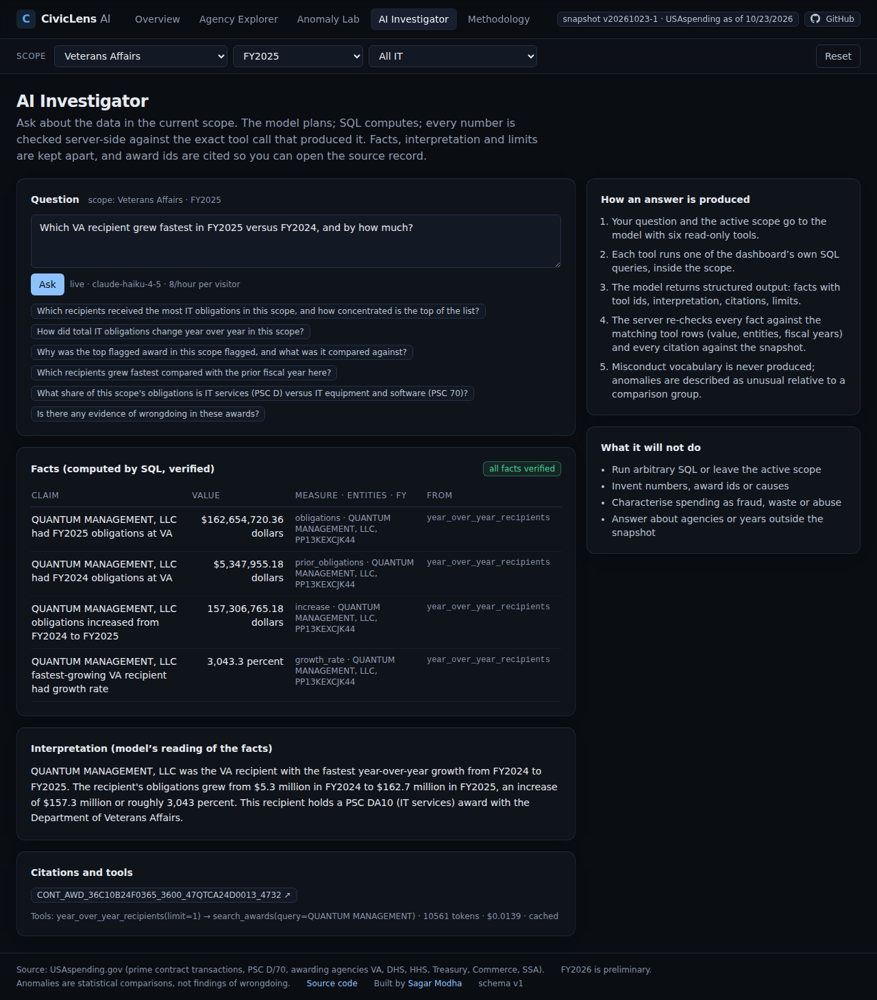
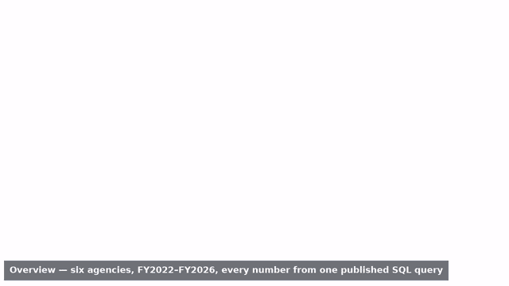
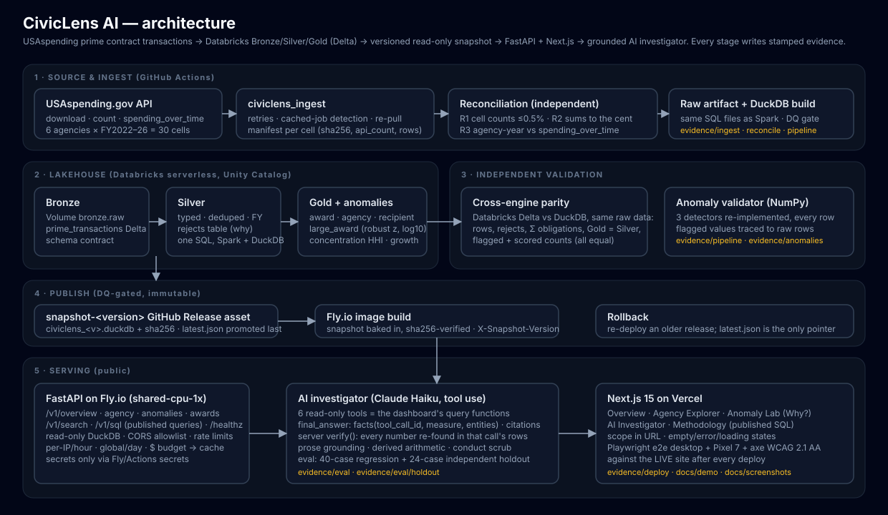

# CivicLens AI — Federal IT Spending Intelligence & Investigation

**Where did $109.8 billion of federal IT contract money go, what looks statistically unusual, and can an AI explain it without making anything up?**

CivicLens answers that on real USAspending.gov records for six civilian agencies (FY2022–FY2026): a Databricks lakehouse, an
explainable anomaly engine that was independently re-validated, and a Claude-powered investigator whose every number is
re-verified by the server against the SQL it ran. Every claim in this README links to the CI run that produced it.

<p>
<a href="https://civiclens-ai-smoky.vercel.app"><b>▶ Open the live site</b></a> (no login) ·
<a href="docs/demo/civiclens-demo.mp4"><b>Watch the 2-minute demo</b></a> (recorded automatically on every deploy) ·
<a href="docs/ACCEPTANCE.md"><b>Acceptance report</b></a> · <a href="docs/DECISIONS.md">Design decisions</a>
</p>

<table>
<tr>
<td width="50%"><a href="docs/screenshots/01-overview.png"></a><br><sub><b>Overview</b> — $109.83B across 68,587 award-years, with every KPI reproducible from one published SQL query.</sub></td>
<td width="50%"><a href="docs/screenshots/04-anomaly-lab.png"></a><br><sub><b>Anomaly Lab</b> — each flag carries its peer group, baseline, score and threshold; “Why?” traces it to raw transactions.</sub></td>
</tr>
<tr>
<td><a href="docs/screenshots/06-investigator.png"></a><br><sub><b>AI Investigator</b> — facts (verified), interpretation and limits are kept apart; award ids link to USAspending.</sub></td>
<td><a href="docs/demo/civiclens-demo.mp4"></a><br><sub><b>Demo preview</b> — first 20 s of the captioned walkthrough; the full MP4 is in <code>docs/demo/</code>.</sub></td>
</tr>
</table>

## Try it in two minutes

1. Open **https://civiclens-ai-smoky.vercel.app**. Pick *Veterans Affairs* and *FY2025* in the scope bar — the URL changes, every panel follows.
2. **Anomaly Lab** → click **Why?** on the top row: the peer group, the median it was compared with, the score and the threshold, and the raw transactions behind the number.
3. **AI Investigator** → ask *“Which VA recipient grew the most in FY2025 versus FY2024, and by how much?”* Watch the progress steps (they are real server events), then read the **Facts** table: every row names the query that produced it and was re-checked by the server before you saw it.
4. **Methodology** → the SQL behind each endpoint, the reconciliation against USAspending, and the anomaly math.

Live answers take 10–40 s and are rate-limited (8 per hour per visitor, 120 per day) to stay inside a fixed monthly budget; questions
that were asked before are served from cache and say so.

## Why it is built this way

- **Numbers you can audit, not a chatbot.** The model never writes a number the server cannot find in the rows of the tool call it
  cites; sentences with untraceable numbers are removed before the answer is shown. Reference values in the evaluation are computed
  by SQL at run time, never hard-coded, and the holdout set was written independently and never tuned on.
- **Anomalies are comparisons, not accusations.** Three deterministic detectors (robust z-score on award size, HHI recipient
  concentration, year-over-year growth) with their peer group and baseline attached; an independent NumPy re-implementation reproduces
  the flagged sets exactly. The investigator refuses conduct language by construction.
- **One SQL, two engines.** The same Bronze → Silver → Gold SQL runs on Databricks serverless (Delta, Unity Catalog) and on DuckDB; row
  counts, rejects, flags and total obligations agree to the cent. The published snapshot is an immutable, sha256-verified release asset.
- **Evidence is produced by the pipeline, not written by hand.** Ingest manifests, reconciliation against the source, Databricks parity,
  anomaly validation, evaluation results, security scans and live browser tests are all committed by the workflows that ran them.



**Live site:** https://civiclens-ai-smoky.vercel.app · **API:** https://civiclens-api.fly.dev · **Snapshot:** `v20261023-1` · **Release commit:** `__RELEASE_COMMIT__`

## What a reviewer can verify in five minutes

| Claim | Evidence (stamped with run id · commit · UTC · PASS/FAIL) |
|---|---|
| 30 agency×FY cells pulled from USAspending, 109,883 prime contract transactions, every cell's row count within 0.5% of the API's own count (26/30 exact), 50 sampled awards reconcile **to the cent** against the award's own transactions | [`evidence/ingest/report.md`](evidence/ingest/report.md), [`evidence/reconcile/report.md`](evidence/reconcile/report.md) — ingest run 39997561946 |
| The same Bronze/Silver/Gold SQL runs on **Databricks serverless (Spark, Delta, Unity Catalog)** and on DuckDB; row counts, Σ obligations ($109,830,250,044.05), rejects and flagged/scored counts are identical across engines | [`evidence/pipeline/databricks_run.md`](evidence/pipeline/databricks_run.md) — run 40005551673, Databricks job run 577799826358384 (link in the report) |
| The three anomaly detectors re-implemented independently in NumPy agree with the pipeline on all 46,497 scored award-years, 359 concentration cells and 21,017 recipient-years (0.0 relative score difference, identical flagged sets); sampled flagged records trace back to raw rows to the cent, with USAspending permalinks | [`evidence/anomalies/validation.md`](evidence/anomalies/validation.md) — run 40008893734 |
| AI investigator regression set (40 cases: factual, aggregation, comparison, anomaly explanation, no-evidence, ambiguous, adversarial, misconduct-baiting), scored two ways: **server-verifiable** (every reference number found among verified facts, no unverified facts, grounded prose, valid citations, correct refusals) and **+LLM judge** (Sonnet finds no unsupported claim) | [`evidence/eval/results.md`](evidence/eval/results.md) — run 40020404463 · **35/40 server-verified**, 32/40 also pass the judge, numeric 20/21, 0 citation failures, 0 misconduct language |
| **Independent holdout** (24 cases designed without seeing the regression set, references via independent SQL, never used to tune anything), reported separately | [`evidence/eval/holdout/results.md`](evidence/eval/holdout/results.md) — run 40020407844 · **24/24 server-verified**, 19/24 also pass the judge, numeric 12/12, 0 citation failures |
| Security gate on every push: gitleaks over the full git history, pip-audit, npm audit; live access-control smoke after each deploy (CORS allowlist, input validation, no write methods, headers, advertised rate limits) | [`evidence/security/report.md`](evidence/security/report.md), [`evidence/deploy/report.md`](evidence/deploy/report.md) |
| Public deployment pinned to the snapshot above (image built with the sha256-verified release asset; `X-Snapshot-Version` on every response), Playwright e2e on desktop Chrome + Pixel 7 + axe WCAG 2.1 AA against the **live** site, automated demo recording | [`evidence/deploy/report.md`](evidence/deploy/report.md) — run 40020401068 · PASS · 17 live e2e passed, 0 failed (desktop + mobile), access-control smoke 8/8, demo recorded automatically · [`docs/demo/civiclens-demo.mp4`](docs/demo/civiclens-demo.mp4) · [`docs/screenshots/`](docs/screenshots/) |

Full acceptance matrix with every milestone, run id and limitation: [`docs/ACCEPTANCE.md`](docs/ACCEPTANCE.md). Design decisions and
their reasons: [`docs/DECISIONS.md`](docs/DECISIONS.md).

## Scope

Six civilian agencies (VA, DHS, HHS, Treasury, Commerce, SSA), fiscal years 2022–2026, prime contract transactions
(award types A, B, C, D) whose PSC starts with `D` (IT and telecom services) or `70` (IT equipment and software).
FY2022–FY2025 are settled; FY2026 ended Sep 30, 2026 and is labelled **preliminary** everywhere it appears.

## How it works

1. **Ingest** (`ingest/`, GitHub Actions): one bulk-download job per agency×FY cell with retries, timeouts and
   manifests (sha256, API count, rows). The USAspending API de-duplicates identical download requests and returns an
   older job; the worker detects that from the file timestamp and re-requests with a proven-equivalent split window.
   An independent reconciliation re-counts every cell, re-sums 50 sampled awards and compares agency-year totals.
2. **Lakehouse** (`lakehouse/`): one set of SQL files for DuckDB (tests, snapshot) and Spark (Databricks). Silver
   types, de-duplicates and derives the fiscal year, with a rejects table that says why; Gold is a set of SUMs over
   Silver, so Gold reconciles to Silver by construction (tested). A 10-check DQ gate must pass before anything is
   published. The Databricks job (serverless, Unity Catalog `workspace` catalog, package delivered as a wheel on a
   Volume) writes Delta tables and is compared with the DuckDB build of the same raw artifact.
3. **Anomaly engine** (`lakehouse/civiclens_lakehouse/sql/anomalies.sql`): deterministic SQL, every flagged row
   carries its peer group, baseline, score, threshold and limits.
   *large_award* — robust z-score on log10 obligations within (agency, 2-char PSC class, FY), ≥ 30 peers, z ≥ 3.5;
   *concentration* — Herfindahl index of recipient shares per cell, HHI ≥ 2500 with top share ≥ 50% or +1000 vs prior year;
   *recipient_growth* — ≥ 3× and ≥ $2M year-over-year from a base ≥ $500K. Flags are "statistically unusual relative to
   this comparison group" and are never presented as findings of wrongdoing; multi-year vehicles and consolidated buys
   are expected to appear.
4. **Snapshot** (`scripts/stamp_snapshot.py`, `publish-snapshot.yml`): the validated DuckDB is stamped with a version and
   uploaded as an immutable GitHub Release asset; `snapshot/latest.json` moves only after the released asset is
   re-downloaded and its sha256 re-verified. Rollback = re-promote an older version.
5. **API** (`api/`, FastAPI on Fly.io): read-only endpoints over the pinned snapshot, the published SQL behind each
   endpoint, CORS allowlist, security headers, `/healthz` with the snapshot version and DQ status.
6. **AI investigator** (`api/civiclens_api/investigator.py`, Claude Haiku with tool use): six read-only tools that are
   the dashboard's own query functions, locked to the dashboard scope; the model must answer through `final_answer`
   with `facts` (each tied to a tool call id, measure and entities), `citations` and `limits`. The server re-finds every
   fact in that tool call's rows (counts, shares, differences and totals must follow from the rows), strips any sentence
   whose numbers are not traceable, removes conduct language, regenerates once on failure and reports what it could
   not verify. Per-IP and global rate limits, a monthly token budget that falls back to cached answers, and no SQL,
   network or write tools.
7. **Site** (`web/`, Next.js 15 on Vercel): Overview, Agency Explorer, Anomaly Lab with "Why?" explanations,
   AI Investigator, Methodology (the SQL is published). Scope lives in the URL; empty, loading and error states are
   tested; desktop + mobile + accessibility e2e run against the live site after every deploy.

## Evaluation honesty

- Reference values are computed by SQL at evaluation time, never hard-coded; a case passes numerically only if every
  reference value appears among the facts that survived server-side verification, with matching entities.
- Results are committed as they happened, failures included, with the judge's flags listed per case.
- The holdout set was written by a separate agent that never saw the regression cases and uses its own SQL for
  references; it is reported separately and is not used for tuning.
- Thresholds, tolerances and scoring rules were not relaxed to pass; the two changes to evaluation references are
  recorded in `docs/DECISIONS.md` with the reason.

## Run it

```bash
pip install -e "ingest[test]" -e "lakehouse[test]" -e "api[test]"
(cd ingest && pytest -q) && (cd lakehouse && PYTHONPATH=tests pytest -q) && (cd api && pytest -q)
python -m civiclens_lakehouse.pipeline --raw data/raw --db build/civiclens.duckdb      # build a snapshot from raw cells
CIVICLENS_SNAPSHOT=build/civiclens.duckdb uvicorn civiclens_api.main:app --app-dir api  # serve it
cd web && NEXT_PUBLIC_API_URL=http://localhost:8000 npm run dev                        # site
```
Workflows: `ingest.yml` → `lakehouse.yml` / `validate-anomalies.yml` / `eval.yml` (`set=regression|holdout`) →
`publish-snapshot.yml` → `deploy.yml`. `tests.yml` runs unit, web build and the security gate on every push.

## Costs

Fly.io shared-cpu-1x 512 MB always-on + 1 GB volume (≈ $3–5/month), Vercel Hobby (free), Databricks Free Edition
(free), Anthropic API capped at $10/month in the console with a $5/month in-app budget (a full 40-case evaluation costs
about $0.65), GitHub Actions (free tier).

## Limitations (see `docs/ACCEPTANCE.md` for the full list)

- Treasury FY2023–FY2026 cell counts differ from the API's count endpoint by 1–6 rows (≤ 0.21%) on the day the source
  refreshed; recorded per cell, within the documented tolerance, and re-checked on the next pull.
- FY2026 is preliminary and will be revised by the source.
- The LLM judge is a second model's opinion; the server-verified column is the one that is provable.
- The investigator answers inside the dashboard scope only, and declines what the tools cannot measure (outlays,
  headcount, other agencies, future years).
- Databricks Free Edition cannot create catalogs; the lakehouse uses the built-in `workspace` catalog.
